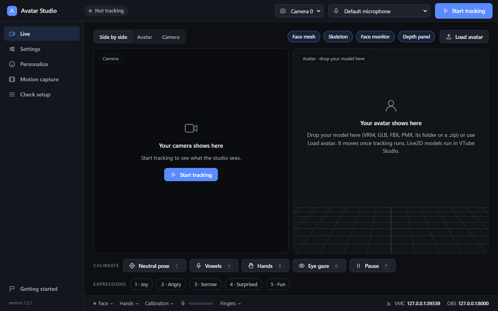
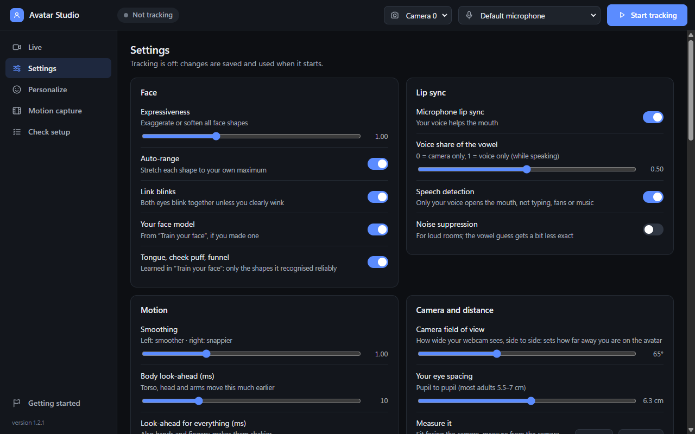
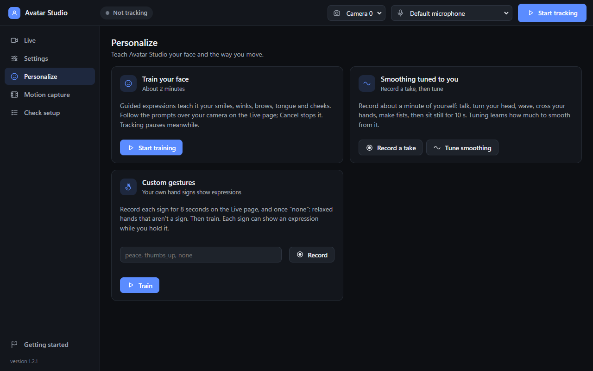
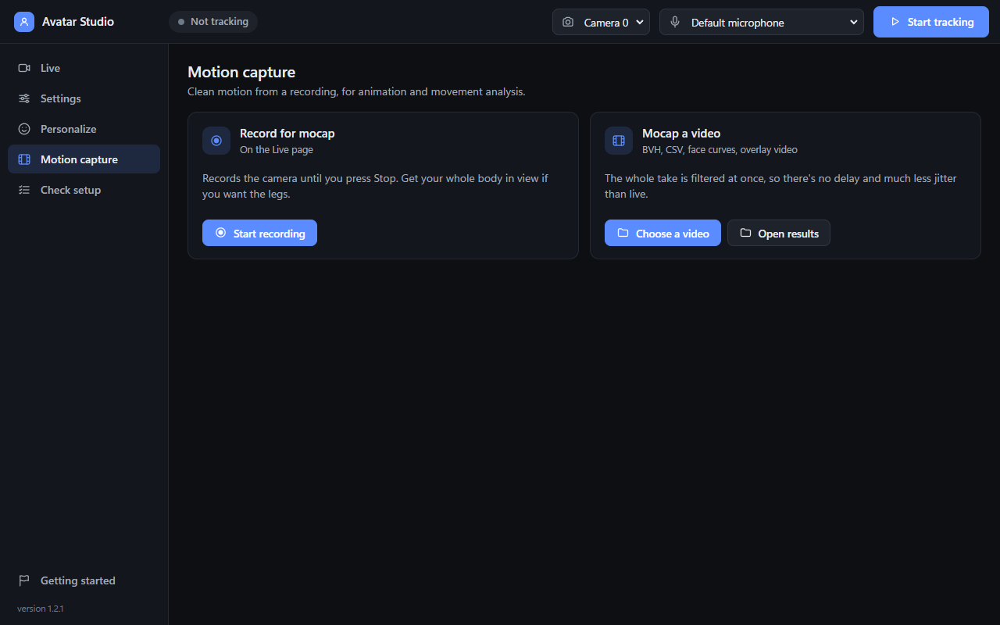
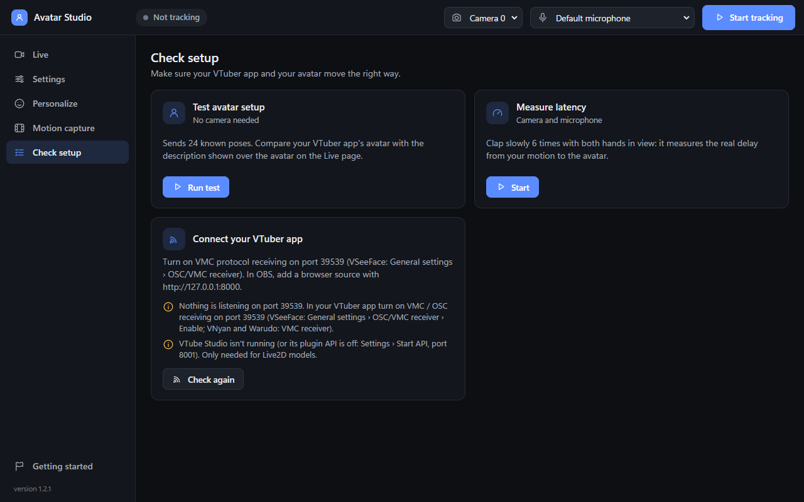

# Webcam Avatar Studio

**Move a VTuber avatar with just your webcam:** face, eyes, expressions, body, arms and every finger.



- Works with **VSeeFace, VNyan, Warudo, VMagicMirror** and anything else that receives VMC, plus **VTube Studio**
  (Live2D).
- Shows your avatar in a **built-in 3D viewer** (VRM, GLB, FBX, PMX) or straight in **OBS**, no other app needed.
- **Microphone lip sync** that ignores typing, fans and music.
- **Motion capture** from a video: BVH for Blender, body and face curves as CSV.
- Runs **entirely on your PC**. Nothing is uploaded.

Free for personal, non-commercial use ([details](#license)).

## Download

**[⬇ Download AvatarStudio.exe](https://github.com/JackLongman12/vtuber-tracker-with-fingers/releases/latest/download/AvatarStudio.exe)**
(Windows 10/11, about 500 MB)

One file, nothing to install. Double-click it; the first start takes a few seconds to unpack, and later starts are
quick. The app updates itself.

> Windows may warn about an unknown publisher (the app isn't code-signed). Click **More info → Run anyway**.

## Getting started

1. **Open the app.** A short guide walks you through the first steps.
2. **Pick your camera** in the top bar and press **Start tracking**.
3. **Calibrate:** sit normally, look at the screen and press **C** (neutral pose). Then **V** to record your vowels
   for better lip sync.
4. **Connect your avatar:**

   | Using | Do this |
   |---|---|
   | The built-in viewer | Drop your model onto the Avatar panel, or click **Load avatar** |
   | VSeeFace, VNyan, Warudo… | Turn on **VMC receiving** on port **39539** (VSeeFace: General settings → OSC/VMC receiver) and turn off that app's own webcam tracking |
   | VTube Studio | Turn on its **API** (port 8001), switch on *VTube Studio (Live2D)* in Avatar Studio's Settings, and click **Allow** when asked |
   | OBS | Settings → **OBS**: pick your `.vrm` and copy the address into a Browser source (transparent background) |

5. **Check it:** the **Check setup** page tells you whether your VTuber app is listening and can run a test pose
   sequence on your avatar.

### Keys

| Key | Does |
|---|---|
| **C** | Neutral pose calibration |
| **V** | Vowel calibration (say A, I, U, E, O) |
| **K** | Hand calibration (open hands, then fists) |
| **G** | Eye gaze calibration (follow the dot with your eyes) |
| **P** | Pause: the avatar holds still, the CPU rests |
| **1–9** | Expressions (Joy, Angry, Sorrow…) |

**Ctrl+Alt+C**, **Ctrl+Alt+P** and **Ctrl+Alt+1–9** work from any window, e.g. while you're in a game or OBS.

## What's in the app

| | |
|---|---|
|  |  |
| **Settings:** face, lip sync, smoothing, camera; changes apply live | **Personalize:** train your face, tune smoothing, teach your own hand signs |
|  |  |
| **Motion capture:** record a take or turn a video into animation | **Check setup:** test your avatar, measure delay, check the connection |

## Optional extras

- **Better fingers (WiLoR):** a 3D hand model on your NVIDIA GPU that handles fists and overlapping fingers better.
  Settings → *WiLoR finger helper* → **Install** (about 4 GB). You need the free MANO hand model from
  [mano.is.tue.mpg.de](https://mano.is.tue.mpg.de) (registration required). Non-commercial use only.
- **Train your face** (Personalize, about 2 minutes): learns your expressions, including tongue out and cheek puff.
- **Custom gestures** (Personalize): record your own hand signs and choose which expression each one triggers.
- **Second or third camera** *(experimental)*: Settings → *Second camera*, then press C to line it up. A phone works too (Windows 11 *Phone Link*,
  DroidCam or Camo); use USB and turn off the phone's beauty filters and auto-framing.
- **GPU tracking** (Settings): runs the face and body models on your graphics card for a little less delay.

## Motion capture

Record a take on the **Motion capture** page (or choose any video), then press **Mocap a video**. You get:

- `motion.bvh` for Blender, Unity or MotionBuilder
- body points and joint angles as CSV
- 52 ARKit face curves as CSV
- `overlay.mp4`, the video with the skeleton drawn on it

Because the whole take is known, it's smoothed both ways in time: no lag and much less jitter than live.

## Tips

- **Light your face from the front** and keep your upper body in view.
- **One tracker at a time:** turn off your VTuber app's own webcam tracking.
- **Fingers:** one webcam can't see fingers hidden behind other fingers. WiLoR or a second camera helps.
- **Something wrong?** Settings → **Report a problem** builds a bug report with personal details removed. You see all
  of it before anything is sent.

## Updates and uninstalling

- **Updates:** the app checks on start and shows **Update** in the top bar. Updates are verified before they're
  installed, and your settings and calibration are kept.
- **Uninstall:** Settings → **Uninstall Avatar Studio…** removes everything. Your data (calibration, training,
  recordings) is kept unless you tick *Also delete my data*; then it goes to the Recycle Bin.
- **Your data** lives in `%APPDATA%\AvatarStudio`.

## macOS and Linux

The app runs from source there (not tested on real hardware yet, reports welcome):

```bash
python3 -m venv .venv
.venv/bin/pip install -r requirements.txt
.venv/bin/python app.py
```

Linux also needs `sudo apt install libportaudio2` and `pip install "pywebview[gtk]"`. More in the
[technical notes](docs/TECHNICAL.md#macos-and-linux).

## More

- **[Technical notes](docs/TECHNICAL.md):** how it works, measurements, command-line options, the manual WiLoR setup
- **[Development](docs/DEVELOPMENT.md):** project layout, building the app, publishing releases
- **[Report a bug or ask for a feature](https://github.com/JackLongman12/vtuber-tracker-with-fingers/issues)**

## License

The code is [MIT](LICENSE). Some models it uses were trained on non-commercial research data, and the optional
WiLoR fingers are licensed for non-commercial use only. So Avatar Studio is for **personal, non-commercial use**:
don't sell it, and check the licences in [THIRD_PARTY_NOTICES.md](THIRD_PARTY_NOTICES.md) before using it for
anything that earns money (e.g. monetized streams with WiLoR on).
